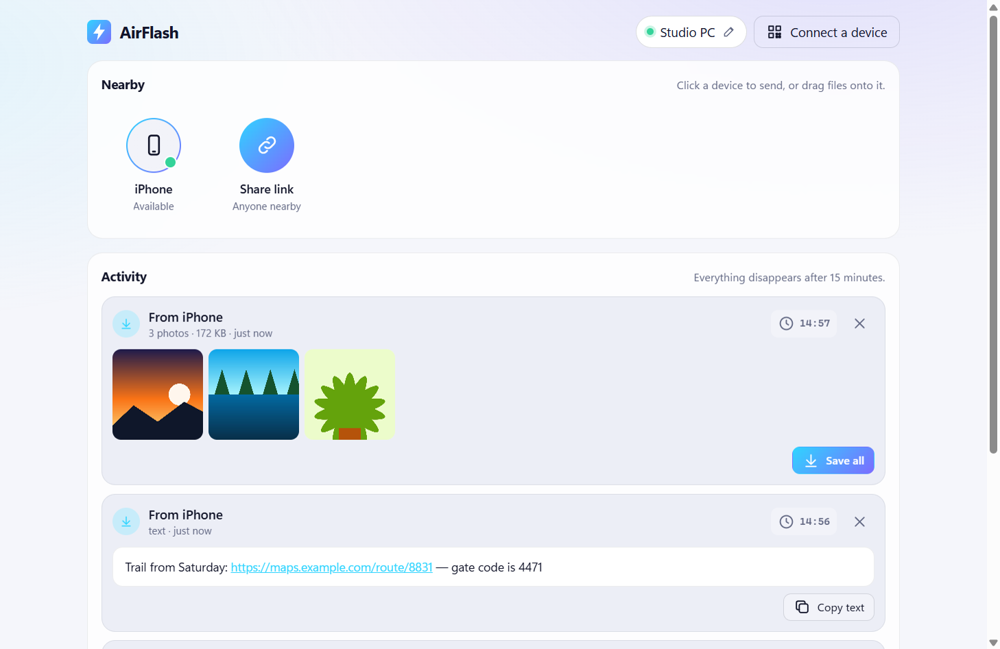
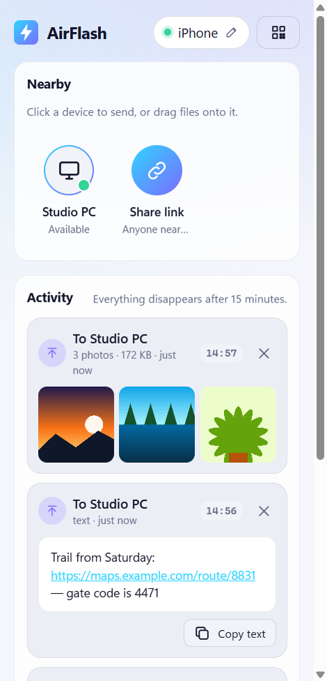

# AirFlash

[](https://github.com/michaelmandich/airflash/actions/workflows/ios.yml)
[](LICENSE)

AirDrop for everything else. Send photos, videos, files and text between your
Windows PC, Mac and iPhone on the same network, with no accounts, no cloud and
no size limit. Everything you send is temporary: a drop lives for 15 minutes
on the LAN and is then deleted. When you are away from home, the same node
runs as a relay on a Raspberry Pi behind a Cloudflare Tunnel, gated by an
access key.




## Features

- **Desktop app** for Windows and macOS (Electron). Lives in the tray and
  receives in the background. Drag files onto a device to send; received
  files save straight to `Downloads/AirFlash`.
- **15-minute drops.** Files stream to disk with no size limit beyond free
  space and expire 15 minutes after the last file finishes uploading. Send
  to a phone whose browser is closed: it is waiting there when the phone
  opens AirFlash within the window.
- **Share links.** Drop something on *Share link* to get a short code, a URL
  and a QR code that anyone on the network can open, like a 15-minute
  imgur/pastebin.
- **Multi-node.** Every desktop app runs a node; nodes find each other over
  mDNS/Bonjour and forward sends, so a phone connected to your PC can send to
  your Mac.
- **iPhone app** (Capacitor). A share-sheet extension ("Share -> AirFlash"),
  background uploads that survive the phone locking, originals from the photo
  picker, received photos and videos saved straight to Photos, and Bonjour
  discovery so you rarely need the QR code. It builds with a free Apple ID.
- **Relay mode.** Start the node with an access key and it stops trusting
  the network: key-gated API, chunked uploads that fit under Cloudflare's
  100 MB request cap and resume after a lost request, 24-hour expiry, per-file
  and whole-store quotas, and a brute-force guard on keys and share codes.
- **No build step** for the UI: vanilla JS served by the node to every device.

## Architecture

```
  your LAN (trusted, like AirDrop "Everyone")          away from home (relay mode)

  iPhone app ---HTTP---> node on your PC               iPhone app or browser
  or Safari              (desktop app, :4747)                 |
                             ^                         https + access key
                             | mDNS _airflash._tcp            v
                             | + /peer/<nodeId>/...    Cloudflare edge --tunnel--> cloudflared
                             v                         (100 MB per request)            |
                         node on your Mac                                    127.0.0.1:4747
                         (desktop app, :4747)                                node, relay mode
                                                                             24 h, quotas, guard
```

- Every desktop app runs a small **node**: an HTTP server on port `4747` that
  serves the web UI, stores drops in a temp folder, and pushes live updates
  over Server-Sent Events.
- Nodes advertise `_airflash._tcp` and share their device lists. Cross-node
  sends go through `/peer/<nodeId>/...`, so the UI only ever talks to its own
  node.
- A **drop** is a set of files and/or text addressed to one device (or to a
  share link). Files are served back with HTTP Range support (iOS needs it for
  video).
- **Identity:** each device makes a random secret and keeps it locally. Other
  devices only ever see a hash of it, so nobody can list your inbox. Drop and
  file ids are 128-bit random values.
- The **iPhone app** bundles the same `src/web` UI in a WebView and adds the
  native parts (picker, background uploader, share extension, Photos, Bonjour)
  through Capacitor plugins. It talks to a node, LAN or relay, over CORS.
- A **relay** is the same node bound to loopback behind a tunnel, started with
  an access key. The design, every flag and the chunk protocol are in
  [docs/relay-mode.md](docs/relay-mode.md).

## Security model

LAN mode trusts the network, the same as AirDrop's "Everyone" setting: anyone
on it can see device names and send you things, and nobody can read your
inbox. Relay mode adds the access key, upload tokens and share codes as
capabilities, the brute-force guard and quotas. Uploaded files are never
rendered, only served as downloads under a sandboxing CSP, and the node only
answers to IP addresses, `localhost`, `*.local`, its hostname and
`--allowed-hosts`, which blocks DNS rebinding.

What it does not do: there is no end-to-end encryption (the relay operator can
read what is on the relay while it exists), the event stream carries the key
and device secret in its query string because `EventSource` cannot send
headers, and LAN peers trust mDNS advertisements. The full threat model and
how to report a vulnerability are in [SECURITY.md](SECURITY.md).

## Quick start

```bash
npm install
npm run desktop      # the desktop app
npm start            # or: headless node only, http://localhost:4747
```

Then on your phone: click **Connect a device** in the app and scan the QR
code. Safari works as is; the iPhone app is better (see below).

> **Windows:** the first launch shows a Windows Firewall prompt. Allow it on
> **Private networks**, and make sure your Wi-Fi/Ethernet profile is set to
> *Private*. Otherwise your phone cannot reach the PC.

Headless flags: `--host`, `--port`, `--name`, `--data`, `--allowed-hosts`,
`--no-discovery`, plus the relay flags below (env: `AIRFLASH_HOST`,
`AIRFLASH_PORT`, `AIRFLASH_NAME`, `AIRFLASH_ALLOWED_HOSTS`, ...). Bind
`--host 127.0.0.1` when a tunnel or reverse proxy fronts the node and list its
public hostname in `--allowed-hosts`.

### iPhone in Safari (no app)

- Browsers only allow the clipboard and share sheet on HTTPS pages, and a LAN
  node is plain HTTP. So: **long-press a photo -> Save to Photos**. Videos
  download to the Files app.
- Keep the tab in the foreground while *sending* big videos; iOS pauses
  background tabs.
- Safari may convert HEIC photos to JPEG and compress videos when you pick
  them. That is iOS behaviour, not AirFlash. The app fixes both.

## The iPhone app

The Xcode project is committed under `ios/` (an `App` target and a
`ShareExtension` target, no workspace). Development happens on any OS; a Mac
is needed only to sign and run on a phone, and a free Apple ID is enough.

```bash
npm ci
npm run build:mobile     # copies src/web into www/ and bundles src/mobile/native.js
npx cap sync ios
open ios/App/App.xcodeproj
```

Set your own team and bundle ids in Xcode and press Run. The step-by-step
Mac checklist, including the weekly re-sign a free Apple ID needs, is
[docs/ios-mac-setup.md](docs/ios-mac-setup.md); the design, the plugins chosen
and why, and the risks are in [docs/ios-build-plan.md](docs/ios-build-plan.md).
CI compiles the app and the extension on every push.

## The relay

Any node becomes a relay when it is given an access key. A local try:

```bash
openssl rand -base64 24 > access.key
npm start -- --access-key-file ./access.key --allowed-hosts relay.example.com \
             --host 127.0.0.1 --trust-proxy --ttl 24h --max-request-bytes 100mb --no-discovery
```

Put a Cloudflare Tunnel (or any HTTPS reverse proxy) in front, hand the key to
your people out of band, and the web UI asks for it once; the iPhone app has a
field for it on its Server screen. `deploy/pi/` has an installer, a systemd
unit, a verify script and Cloudflare Tunnel notes for a Raspberry Pi:
[deploy/pi/README.md](deploy/pi/README.md). The behaviour of a relay node,
the flags and the chunked-upload protocol are in
[docs/relay-mode.md](docs/relay-mode.md).

## Testing

```bash
npm test
```

50 integration tests under `test/` (`node --test`) start real nodes on random
ports: two LAN nodes finding each other and forwarding, uploads and Range
requests, expiry, CORS, the relay's key gate and guard, quotas, the chunk
routes and the browser's chunked uploader against a real relay, and the CLI's
flags and exit codes. The GitHub Actions workflow compile-checks the iOS app
and share extension, unsigned, on a macOS runner; signing is only proven on a
Mac. `deploy/pi/test/` has container tests for the Pi installer (Docker).

## Building installers

```bash
npm run dist:win     # on Windows -> dist/AirFlash Setup x.y.z.exe
npm run dist:mac     # on a Mac   -> dist/AirFlash-x.y.z.dmg (unsigned)
```

Mac builds have to happen on a Mac. Unsigned apps need right-click -> Open the
first time.

## Project layout

```
bin/airflash.js            headless node (CLI): flags, env, exit codes
src/core/                  the node: HTTP API, drops + expiry, devices, chunked uploads,
                           access key + brute-force guard, quotas, mDNS discovery
src/web/                   the UI (vanilla JS, no build step), served by the node
                           and bundled into the iPhone app
src/desktop/               Electron shell: tray, window, downloads, notifications
src/mobile/native.js       native glue for the iPhone app: picker, uploader,
                           share sheet, Photos, Bonjour, notifications
native/airflash-bonjour/   in-repo Capacitor plugin: Bonjour browsing (Swift, NWBrowser)
ios/                       the Xcode project: App + ShareExtension targets
scripts/                   make-icons.js, build-mobile.js, ios-add-share-extension.js
deploy/pi/                 Raspberry Pi relay: installer, systemd unit, verify, tunnel notes, tests
docs/                      relay-mode.md, ios-build-plan.md, ios-mac-setup.md, images/
test/                      integration tests (node --test)
```

## Roadmap

1. **Native chunked uploads on iOS**, so files over the relay's request cap
   can be sent from the phone (today they go whole over the LAN or from a
   computer).
2. **Accounts / per-person keys** on the relay, behind the existing
   `authorize()` hook.
3. **End-to-end encryption** for relay mode, so the relay only ever stores
   ciphertext.
4. **Pairing / trusted devices** on the LAN: approve a device once, require
   approval from everyone else.
5. **Android.**

## Contributing and license

See [CONTRIBUTING.md](CONTRIBUTING.md). Security reports go through
[SECURITY.md](SECURITY.md). AirFlash is released under the
[MIT License](LICENSE).
